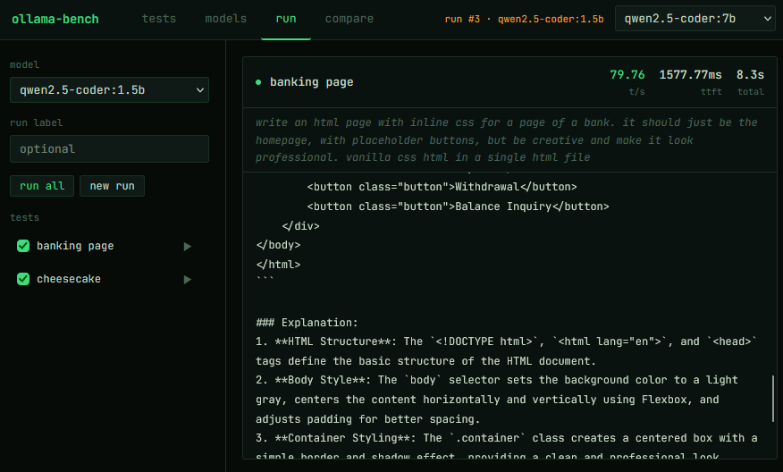

# ollama-bench



`ollama-bench` is a small tool I built for me to easily compare multiple LLM models through [Ollama](https://ollama.com). It lets you define a set of prompts, run them against different locally available models, and compare their responses and performance.

The project was also primarily built with the help of the AI models that it was made to test. The code is therefore largely put together by those models.

## Features

- Connects to an Ollama instance and lists its available models.
- Pulls models through the UI.
- Create, edit, and delete reusable test prompts.
- Run all tests, or a selected subset, against a model.
- Compare results from multiple model runs.
- Records responses, tokens per second, time to first token, and total run time.
- Stores tests and run history in SQLite.

## Requirements

- Python 3.12+
- An Ollama instance with at least one model pulled

## Run locally

```bash
git clone https://github.com/drextrime/ollama-bench.git
cd ollama-bench

python -m venv .venv
source .venv/bin/activate  # Windows: .venv\\Scripts\\activate

pip install -r requirements.txt
cp .env.example .env
```

Set `OLLAMA_HOST` in `.env` to the address of your Ollama server. For example:

```env
OLLAMA_HOST=http://localhost:11434
DB_PATH=ollama_bench.db
```

Start the app:

```bash
python run.py
```

Open [http://localhost:5000](http://localhost:5000).

## Run with Docker Compose

```bash
docker compose up -d --build
```

The app is available on port `8000`.

## Configuration

| Variable | Description | Default |
| --- | --- | --- |
| `OLLAMA_HOST` | Base URL of the Ollama API | `http://localhost:11434` |
| `DB_PATH` | SQLite database file path | `ollama_bench.db` |

## GitHub Container Registry

The included GitHub Actions workflow builds the Docker image and publishes it to GHCR when code is pushed to `main` or a version tag is pushed. It also supports manual runs.

pull the image with:

```bash
docker pull ghcr.io/drextrime/ollama-bench:latest
```


